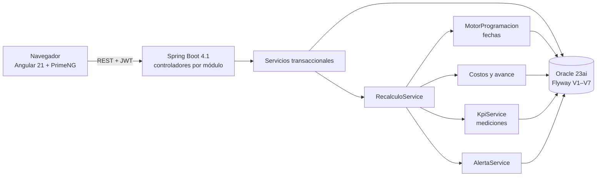
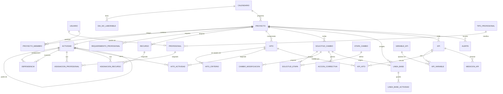

# Gestión Pro · Documentación técnica

Proyecto integrador de Gestión de Proyectos de Software (Duoc UC). Versión del 12-11-2026.

- Frontend: [iscalles/gestion-pro](https://github.com/iscalles/gestion-pro)
- Backend: [iscalles/gestion-pro-backend](https://github.com/iscalles/gestion-pro-backend)
- Demostración: [guion paso a paso](guion-demostracion.md)

## 1. Propósito

Gestión Pro es un sistema de información para dirigir proyectos de software: planificar (EDT, dependencias, calendario), programar (motor tipo MS Project y Carta Gantt), costear (profesionales y recursos), controlar (hitos, KPI con semáforo, alertas) y gestionar cambios con trazabilidad completa. Todo cambio en el plan se propaga en una sola transacción a fechas, costos, avance, indicadores, alertas y tableros.

## 2. Tecnología y justificación

| Capa | Elección | Por qué |
|---|---|---|
| Base de datos | Oracle Database 23ai Free (Docker) | Restricciones `CHECK`, triggers y vistas para que la integridad no dependa solo de la aplicación; columnas calculadas para costos; es el motor que el equipo usa en otras asignaturas. |
| Migraciones | Flyway | El esquema y el caso de prueba se versionan con el código; cualquier integrante recrea la base idéntica con un comando. |
| Backend | Java 21 + Spring Boot 4.1 (JPA, Security, Validation) | Transacciones declarativas (la cadena de recálculo es atómica), validación de entrada con Bean Validation y seguridad por rol con poco código. |
| Autenticación | JWT HS256 | API sin estado; el rol viaja en el token y se verifica con `@PreAuthorize`. |
| Fórmulas de KPI | exp4j | Evalúa expresiones aritméticas con variables del catálogo sin ejecutar código arbitrario (más `MIN` y `MAX` propias). |
| Frontend | Angular 21 (componentes standalone, signals) + PrimeNG 21 | Formularios, tablas y diálogos accesibles listos; PrimeNG 21 sigue siendo MIT (la 22 cambió de licencia). |
| Gráficos y Gantt | SVG propio | Ninguna librería libre dibuja la barra real bajo la planificada ni los cuatro tipos de dependencia; con SVG propio se controla color, accesibilidad y tabla de datos de cada gráfico. |

Se eligió un **monolito modular** en lugar de microservicios: la regla central del sistema es que fechas, costos, KPI y alertas queden consistentes después de cada cambio, y eso se resuelve con una transacción sobre una base, sin coordinación distribuida.

## 3. Arquitectura

**Cadena de recálculo.** Cada operación que cambia el plan (actividad, dependencia, calendario, asignación, recurso, hito o aprobación de un cambio) termina llamando a `RecalculoService.recalcular(proyecto)` dentro de la misma transacción:

1. **Fechas**: el motor reprograma las hojas por sus dependencias y deriva etapas y actividades con hijos.
2. **Costos**: las semanas de cada asignación se recalculan con la nueva duración (duración ÷ días hábiles por semana), así que alargar una actividad encarece el plan.
3. **Avance**: ponderado por duración, de las hojas hacia el proyecto.
4. **KPI**: se evalúa cada fórmula; si cambia el valor o el semáforo se guarda una medición nueva con la solicitud de cambio que la gatilló.
5. **Alertas**: se abren, actualizan o resuelven según el estado resultante.

Si cualquier paso falla (por ejemplo, una dependencia circular o un recurso que quedaría con capacidad insuficiente), no se guarda nada.

## 4. Roles

| Acción | Administrador | Usuario de proyecto |
|---|---|---|
| Ver y trabajar en proyectos | Todos | Solo los que dirige o integra |
| Crear, editar, cerrar y eliminar proyectos | Sí | No |
| Actividades, dependencias, asignaciones, recursos, requerimientos | Sí | Sí, en sus proyectos |
| Calendario laboral y feriados | Sí | Solo lectura |
| Catálogo de profesionales y tipos de profesional | Sí | Solo lectura |
| Hitos, criterios y evidencias | Sí | Sí |
| Crear, editar y eliminar KPI | Sí | No |
| Registrar mediciones manuales de KPI | Sí | Sí |
| Registrar solicitudes, avanzar etapas, acciones correctivas, cerrar | Sí | Sí |
| Aprobar o rechazar solicitudes, eliminar solicitudes recién registradas | Sí | No |
| Tableros | Sí | Sí, de sus proyectos |

El backend aplica las reglas (`@PreAuthorize` y `AccesoProyecto`); el frontend solo oculta los botones que el rol no puede usar.

## 5. Requerimientos y cómo se cumplen

### Módulo 1 · Proyectos

| Requerimiento | Implementación |
|---|---|
| Código, nombre, descripción, responsable, calendario, fechas planificadas y reales, presupuesto, estado, avance, miembros | Tabla `proyecto` + `proyecto_miembro`; pantalla `/proyectos` |
| Estados PLANIFICADO, EN_EJECUCION, SUSPENDIDO, TERMINADO | `ck_proyecto_estado`; cerrar exige actividades al 100 % y solicitudes cerradas (`ACTIVIDADES_ABIERTAS`, `CAMBIOS_ABIERTOS`) |
| Solo se elimina un proyecto sin iniciar | `PROYECTO_INICIADO` |

### Módulo 2 · EDT

| Requerimiento | Implementación |
|---|---|
| Jerarquía etapa → actividad → subactividad | `actividad.padre_id` con `ck_act_padre` (la etapa no tiene padre; lo demás sí); máximo tres niveles (`NIVEL_MAXIMO`) |
| Códigos de la EDT | Se derivan del orden del árbol (1, 1.2, 1.2.3), no se guardan: nunca quedan desfasados al mover o borrar |
| Representación jerárquica | Tabla plegable en `/actividades` y grilla de la Gantt |

### Módulo 3 · Programación

| Requerimiento | Implementación |
|---|---|
| Duración en días hábiles, fechas calculadas | `MotorProgramacion`: orden topológico y reglas de MS Project (sección 7.1) |
| Dependencias FS, SS, FF, SF con desfase | Tabla `dependencia` (`ck_dep_tipo`, desfase −999 a 999); solo entre hojas (`DEPENDENCIA_SOLO_HOJAS`) |
| Detección de ciclos | 422 `DEPENDENCIA_CIRCULAR` con el camino del ciclo |
| Calendario laboral y feriados | `calendario` + `dia_no_laborable`; cambiarlo reprograma todos los proyectos que lo usan |
| Fechas reales y avance | 100 % de avance ⇔ término real (`ck_act_avance_100`, `AVANCE_SIN_TERMINO`, `TERMINO_SIN_AVANCE`) |

### Módulo 4 · Carta Gantt

| Requerimiento | Implementación |
|---|---|
| Barras planificadas y reales, avance, hitos de duración cero | SVG propio en `/gantt`: barra plan con avance pintado, barra real debajo, diamantes para hitos |
| Dependencias visibles | Flechas FS/SS/FF/SF, resaltadas al pasar el puntero |
| Dinámica | Clic en una barra abre el detalle; al guardar, el backend recalcula y la carta se vuelve a dibujar |
| Atrasos | Actividades atrasadas en rojo; hitos atrasados o en riesgo con su estado |

### Módulo 5 · Recursos y costos

| Requerimiento | Implementación |
|---|---|
| Profesionales con tipo, valor hora y horas disponibles | `profesional`, `tipo_profesional` (catálogo del administrador) |
| Requerimientos de profesionales por proyecto | `requerimiento_profesional`; la pantalla marca los tipos sin cubrir |
| Recursos de 4 tipos (licencia, material, equipamiento, otro) | `recurso` con cantidad, costo unitario y periodo |
| Asignación a actividades hoja | `asignacion_profesional`, `asignacion_recurso`; triggers `trg_ap_solo_hoja` y `trg_ar_solo_hoja` |
| Costo planificado y real por actividad, etapa y proyecto | Vistas `v_costo_actividad`, `v_costo_etapa`, `v_costo_proyecto`; valor ganado, SPI y CPI |
| Sobreasignación | Carga semanal por profesional sumando todos sus proyectos; sobre sus horas disponibles se marca en rojo y abre una alerta |
| Capacidad de recursos | No se asigna más de cantidad × periodo (`RECURSO_INSUFICIENTE`) |

### Módulo 6 · Hitos

| Requerimiento | Implementación |
|---|---|
| Fecha comprometida, fecha real, estado, criterios de aceptación, evidencia | `hito`, `hito_criterio`, `evidencia`; `ck_hito_cumplido` (cumplido ⇔ fecha real) |
| Asociación a actividades | `hito_actividad`; la fecha prevista es el término más tardío de sus actividades y, si supera la comprometida, el hito queda **en riesgo** |
| Cumplimiento | Solo se marca cumplido con todos los criterios cumplidos (`CRITERIOS_PENDIENTES`); vencido y pendiente = **atrasado** |
| Duración cero en la Gantt | Diamante en la fecha comprometida y la real o prevista |

### Módulos 7 y 9 · KPI

| Requerimiento | Implementación |
|---|---|
| KPI configurables: fórmula, meta, sentido, umbrales, unidad, periodicidad, responsable | Tabla `kpi`; fórmula sobre el catálogo `variable_kpi`, validada al guardar (`FORMULA_INVALIDA`) y con prueba en vivo |
| Semáforo verde, ámbar, rojo | Sección 7.5 |
| Histórico | `medicion_kpi` con origen (automática, manual, programada) y la solicitud de cambio que la provocó |
| Fuente manual | Mediciones registradas por el usuario (KC-12) |
| Ámbito proyecto, etapa, actividad, hito o cambio | `kpi.ambito` + `ambito_ref_id`; `kpi_hito` para vincular KPI con hitos |
| Mínimo 3 KPI de gestión del cambio con metas, umbrales, históricos y alertas | 12 KPI KC-01 a KC-12 (sección 8) |

### Módulo 8 · Gestión del cambio

| Requerimiento | Implementación |
|---|---|
| Solicitud con tipo, prioridad, solicitante, justificación, impacto en plazo, costo, recursos y alcance, riesgo | `solicitud_cambio` |
| Diez etapas como datos | `etapa_cambio` (catálogo) + `solicitud_etapa` con responsable, fecha límite, fechas de inicio y término, estado y observación |
| Responsable y estado, fecha comprometida y real, costo estimado y real, resultado | Columnas de `solicitud_cambio`; cerrar exige resultado y fecha real (`ck_sc_cierre`) |
| Acciones correctivas | `accion_correctiva` con responsable, compromiso y cierre; no se cierra la solicitud con acciones abiertas |
| Aprobación que modifica el proyecto | Sección 7.6 |
| Trazabilidad | `cambio_modificacion` (valor anterior y nuevo), `linea_base` + `linea_base_actividad`, mediciones de KPI anotadas, impacto real medido |

### Tableros

| Requerimiento | Implementación |
|---|---|
| Tablero 1: ejecución, avance, hitos, presupuesto, recursos, atrasos; filtros por proyecto, etapa, fecha y responsable | `/tableros/proyecto`: cifras clave, curva S plan vs real, avance y costo por etapa, KPI, hitos, actividades por atender, carga del equipo, alertas |
| Tablero 2: estado, tiempos, riesgos, costos, acciones, cumplimiento de etapas, efectividad, adopción; alertas | `/tableros/cambio`: matriz de riesgo, cumplimiento por etapa, costos y tiempos por solicitud, distribución por estado/tipo/etapa, KPI, acciones y alertas; filtros por tipo, prioridad y fechas |
| Se actualizan al modificar actividades, hitos o recursos | Se calculan al consultarlos sobre los datos ya recalculados |

## 6. Modelo de datos

30 tablas, 5 vistas y 3 triggers (`V1__esquema.sql`), más catálogos y el caso de prueba (V2 a V7).

`evidencia` guarda archivos de hitos o de solicitudes de cambio (una de las dos referencias).

### Integridad en la base

| Regla | Dónde |
|---|---|
| Correos en minúscula y únicos; rol administrador o usuario de proyecto | `uk_usuario_correo`, `ck_usuario_correo`, `ck_usuario_rol` |
| Fechas de término ≥ inicio (proyecto, actividad, real y plan) | `ck_proyecto_fechas`, `ck_act_fechas`, `ck_act_fechas_real` |
| Proyecto terminado tiene término real | `ck_proyecto_terminado` |
| Avance entre 0 y 100; 100 % exige término real | `ck_act_avance`, `ck_act_avance_100` |
| Tipos de actividad y relación con el padre | `ck_act_tipo`, `ck_act_padre`, `ck_act_no_self` |
| Dependencias únicas, sin autodependencia, tipo válido | `uk_dep_par`, `ck_dep_no_self`, `ck_dep_tipo` |
| Recursos y asignaciones con cantidades y costos positivos | `ck_recurso_*`, `ck_ap_*`, `ck_ar_*` |
| Asignaciones solo en hojas; un padre no recibe recursos | triggers `trg_ap_solo_hoja`, `trg_ar_solo_hoja`, `trg_act_padre_sin_recursos` |
| Hito cumplido ⇔ fecha real | `ck_hito_cumplido` |
| Solicitudes: tipo, prioridad, probabilidad, impacto, estado válidos; decisión con aprobador y fecha; cierre con resultado | `ck_sc_*` |
| Etapa del cambio entre 1 y 10, una por solicitud | `ck_ec_numero`, `uk_se` |

Además, cada formulario valida en el backend (Bean Validation, 400 con el detalle por campo) y las reglas de negocio responden 422 con un código (`DEPENDENCIA_CIRCULAR`, `RECURSO_INSUFICIENTE`, `CRITERIOS_PENDIENTES`, `RIESGO_SIN_EVALUAR`…). Las violaciones de restricciones de Oracle se traducen a 409 con el nombre de la restricción.

## 7. Reglas de cálculo

### 7.1 Programación

Las hojas se ordenan por sus dependencias (Kahn) y cada una empieza en el primer día hábil que cumple todas sus predecesoras y el inicio del proyecto. Con días inclusivos y desfase `d` en días hábiles:

| Tipo | Regla |
|---|---|
| FS | inicio B ≥ término A + 1 + d |
| SS | inicio B ≥ inicio A + d |
| FF | término B ≥ término A + d |
| SF | término B ≥ inicio A − 1 + d |

Etapas y actividades con hijos toman el inicio mínimo y el término máximo de sus hijos; su duración se cuenta en días hábiles del calendario.

### 7.2 Costos

- **Planificado** de una asignación de profesional = horas por semana × semanas × valor hora, con semanas = duración ÷ días hábiles por semana. De un recurso = cantidad × costo unitario.
- **Real** = horas reales × valor hora + costo real de los recursos.
- **Valor ganado (EV)** = Σ costo planificado de cada hoja × su avance.
- **Valor planificado (PV)** = costo planificado de lo que, según el calendario, debía estar hecho a la fecha.
- **SPI** = EV ÷ PV; **CPI** = EV ÷ costo real. La desviación de cada actividad se compara contra su valor ganado, no contra el total, para no marcar como sobrecosto una actividad a medio camino.

### 7.3 Avance

Hojas: lo registra el responsable. Padres y proyecto: promedio de sus hijos ponderado por duración. La curva S del tablero suma, semana a semana, el trabajo planificado acumulado y el real (las actividades en curso reparten su avance de hoy en forma lineal desde su inicio real).

### 7.4 Carga y sobreasignación

Por profesional y semana se suman las horas de todas sus asignaciones (en todos los proyectos) y se comparan con sus horas disponibles. Sobre el 100 % la semana queda sobreasignada y se abre una alerta con el detalle de qué actividades aportan las horas.

### 7.5 Semáforo de KPI

Cada KPI define los límites verde y ámbar. Verde si el valor está dentro de [verdeMin, verdeMax]; si no, ámbar si está dentro de [ámbarMin, ámbarMax]; si no, rojo. Un límite vacío significa "sin límite" por ese lado, lo que cubre los tres sentidos:

| Sentido | Ejemplo | Límites |
|---|---|---|
| Mayor es mejor | KP-01 avance | verde ≥ 40, ámbar 30–40 |
| Menor es mejor | KP-03 desviación de costos | verde ≤ 5, ámbar 5–10 |
| Rango | KP-05 utilización | verde 70–100, ámbar 50–110 |

### 7.6 Aprobación de un cambio

Al aprobar (solo el administrador, en la etapa 4 y con el riesgo calificado), en una transacción:

1. Se guarda una **línea base** con las fechas, duraciones y costos vigentes.
2. Se aplica cada **modificación** propuesta (duración de actividad, tipo o desfase de dependencia, horas de una asignación, cantidad o costo de un recurso, fecha comprometida de un hito, presupuesto o término comprometido del proyecto), registrando valor anterior, nuevo y fecha.
3. Se ejecuta la **cadena de recálculo** (sección 3).
4. Se mide el **impacto real** (días hábiles de término y costo planificado) y se anotan las mediciones de KPI con la solicitud que las provocó.

La respuesta muestra término y costo antes y después, actividades reprogramadas, la línea base creada y los KPI que cambiaron. Las líneas base se comparan en `/cambios` (pestaña Líneas base).

### 7.7 Alertas

| Tipo | Se abre cuando |
|---|---|
| Sobreasignación | un profesional supera sus horas disponibles en alguna semana |
| KPI fuera de meta | el semáforo queda ámbar o rojo |
| Actividad atrasada | el término planificado venció sin avance completo |
| Hito atrasado | la fecha comprometida venció y sigue pendiente |
| Cambio atrasado | la solicitud o una de sus etapas venció |
| Riesgo crítico | una solicitud en curso tiene probabilidad e impacto altos |
| Desviación de costo | el costo real supera el planificado (actividad, solicitud o presupuesto) |

Se recalculan con cada cambio: se actualiza el texto de las que siguen, se resuelven las que ya no aplican y quedan en el historial.

## 8. KPI del caso de prueba

### Proyecto e hitos (Tablero 1)

| Código | KPI | Fórmula | Meta | Por qué es de alto valor para la dirección |
|---|---|---|---|---|
| KP-01 | Avance del proyecto | trabajo completado ÷ trabajo total × 100 | 100 % (verde ≥ 40 %) | Resume en un número dónde está el proyecto; el umbral sigue a la línea base de mediados de noviembre |
| KP-02 | Cumplimiento de hitos | hitos cumplidos en plazo ÷ hitos vencidos o completados × 100 | 90 % | Los hitos son los compromisos con el cliente |
| KP-03 | Desviación de costos | (costo real − PV) ÷ PV × 100 | 0 % (verde ≤ 5 %) | Detecta sobrecostos antes de que consuman el presupuesto |
| KP-04 | Actividades atrasadas | atrasadas ÷ evaluadas × 100 | 5 % | Indicador temprano de atraso del cronograma |
| KP-05 | Utilización de profesionales | horas asignadas ÷ disponibles × 100 (semana actual) | 85 % (verde 70–100 %) | Ni equipo ocioso ni sobrecargado; sobre 100 % hay sobreasignación |
| KP-06 | Cumplimiento de actividades | terminadas en plazo ÷ terminadas × 100 | 90 % | Mide la calidad de la estimación |
| KP-07 | SPI | EV ÷ PV | 1 (verde ≥ 0,95) | Estándar de valor ganado: bajo 1 se produce menos de lo planificado |
| KP-08 | Criterios del hito H4 | criterios cumplidos ÷ total × 100 | 100 % | Avance real hacia la integración de módulos |

### Gestión del cambio (Tablero 2)

| Código | KPI | Fórmula | Meta |
|---|---|---|---|
| KC-01 | Tasa de aprobación | aprobadas ÷ decididas × 100 | 70 % (rango 50–85 %) |
| KC-02 | Tiempo promedio de evaluación | días registro → decisión | ≤ 5 días |
| KC-03 | Tiempo promedio de implementación | días aprobación → cierre | ≤ 15 días |
| KC-04 | Cambios atrasados | atrasados ÷ en curso × 100 | 0 % |
| KC-05 | Costo de cambios sobre presupuesto | costo de cambios ÷ presupuesto × 100 | ≤ 5 % |
| KC-06 | Cumplimiento de etapas | etapas a tiempo ÷ vencidas o completadas × 100 | 90 % |
| KC-07 | Efectividad de los cambios | promedio de efectividad al cierre | 85 % |
| KC-08 | Adopción del cambio | promedio de adopción medida | 80 % |
| KC-09 | Riesgos críticos abiertos | solicitudes en curso con probabilidad e impacto altos | 0 |
| KC-10 | Cierre de acciones correctivas | cerradas ÷ registradas × 100 | 100 % |
| KC-11 | Desviación de plazo por cambios | días hábiles agregados al término | ≤ 5 días |
| KC-12 | Satisfacción con los cambios | encuesta mensual (manual) | 80 % |

Todos tienen umbrales, histórico y alertas; el administrador puede crear otros desde `/kpi` combinando las variables del catálogo.

## 9. Caso de prueba

PRY-2026-01 · Sistema de Inventario Regional (01-09-2026 a 29-01-2027 comprometido, presupuesto $48.500.000):

| Elemento | Mínimo de la rúbrica | Cargado |
|---|---|---|
| Etapas | 4 | 4 (Análisis, Diseño, Construcción, Implantación) |
| Actividades | 12 | 12 |
| Subactividades | 20 | 20 |
| Tipos de dependencia | 4 | FS, SS, FF y SF (25 dependencias) |
| Profesionales | 5 | 5 (más el catálogo de la organización) |
| Tipos de recurso | 4 | licencia, material, equipamiento y otro (10 recursos) |
| Hitos | 6 | 6 (dos cumplidos, uno fuera de plazo; uno vencido; tres pendientes) |
| KPI de proyecto e hitos | 8 | 8 |
| Solicitudes de cambio | 5 | 5 en distintos estados (cerrada, en implementación, rechazada, en evaluación, recién registrada) |
| KPI de gestión del cambio | 12 | 12 |
| Tableros | 2 | 2 |

El caso tiene situaciones a propósito: un profesional sobreasignado, un hito vencido, una solicitud atrasada, otra con riesgo crítico y acciones correctivas vencidas, para que los tableros y las alertas muestren casos reales.

## 10. Pruebas

| Prueba | Qué verifica |
|---|---|
| `MotorProgramacionTest` | las cuatro dependencias con desfase cero, positivo y negativo; feriados; varias predecesoras; propagación de un cambio de duración; derivación de padres; ciclos de dos y tres actividades; dependencias solo entre hojas |
| `CalendarioLaboralTest` | alinear, sumar y contar días hábiles con fines de semana y feriados |
| `CostoServiceTest` | costo de hojas acumulado en etapas; EV y PV según avance y calendario; semanas de una asignación; código EDT derivado del árbol |
| `EvaluadorFormulaTest` | variables del catálogo, fórmulas inválidas, evaluación, sin datos o división por cero |
| `SemaforoTest` | mayor es mejor, menor es mejor, sin franja ámbar |
| `CurvaRealTest` | avance real acumulado de la curva S (sin inicio, antes del inicio, terminada, en curso) |
| `FormatoAlertaTest` | textos de alertas con coma decimal y estados en español |
| `PlanificacionOracleIT` | contra Oracle: crea la jerarquía, recalcula sucesoras y rechaza ciclos |

Comando: `./mvnw test` (46 pruebas, sin base de datos) y `./mvnw test -Dtest=PlanificacionOracleIT` (con Oracle levantado).

Pruebas de integración manuales sobre el caso de prueba (ensayadas con los datos recién cargados):

| Acción | Efecto verificado |
|---|---|
| Pruebas funcionales de 8 a 10 días | término del proyecto 28-12-2026 → 30-12-2026; 7 elementos reprogramados; H5 queda en riesgo; costo planificado $30.165.000 → $30.485.000; KP-01 baja (el trabajo total crece) |
| Asignar a Diego Rojas 20 h/semana en Pruebas funcionales | costo planificado → $31.365.000; Diego queda sobreasignado (50 h de 40) las semanas del 30-11 y 07-12; alertas de sobreasignación |
| Aprobar SC-004 | línea base LB-02; H4 pasa a en riesgo; Backend API inventario 15 → 18 días, Tomás Vidal 30 → 35 h/semana, presupuesto $48.500.000 → $50.600.000; término → 05-01-2027 (+3 días hábiles, el 01-01 es feriado); costo planificado → $32.385.000; nueve KPI con mediciones nuevas anotadas con SC-004 (KC-01, KC-02, KC-05, KC-06, KC-11, KP-01, KP-03, KP-05 y KP-07) |
| Usuario de proyecto | no ve crear/editar KPI, aprobar/rechazar ni el catálogo; sí registra mediciones y avanza etapas |

## 11. Limitaciones conocidas

- Un solo calendario por proyecto (no por profesional).
- Las mediciones programadas de KPI corren una vez al día (06:00) además de cada recálculo; no hay periodicidad por hora.
- Las evidencias se guardan en la base (máximo 10 MB por archivo), suficiente para el alcance académico.
